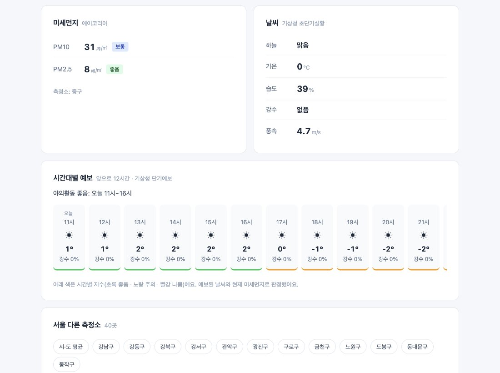
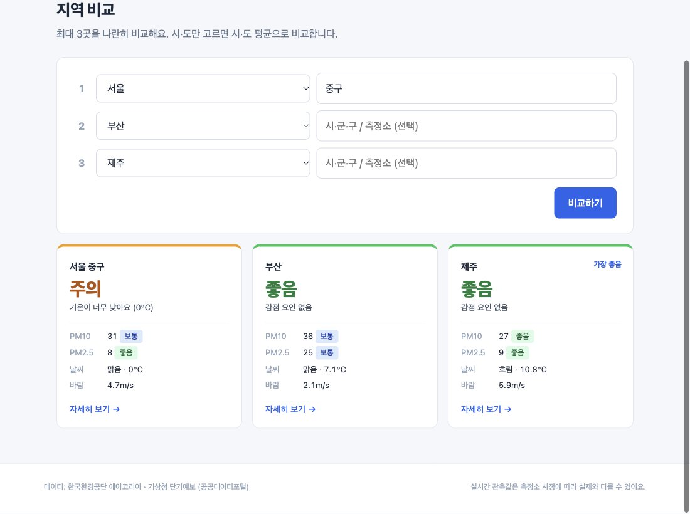
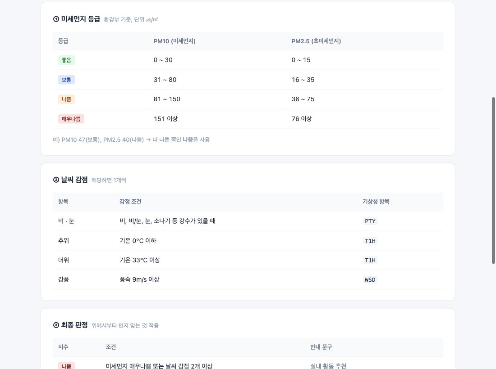

# ☀ 야외활동 지수 (Outdoor Activity Index)

> 지역을 검색하면 **미세먼지(에어코리아) + 날씨(기상청)** 를 한 화면에 묶어 보여주고,
> 두 정보를 합쳐 오늘 야외활동을 해도 되는지 **좋음 · 주의 · 나쁨** 으로 알려주는 웹 서비스

OpenAPI 융합 팀 프로젝트 **2팀** · 서버 구축 관리 (김철진 교수)
JSP · `java.net.http.HttpClient` · Gson · Model 2 · Tomcat 11 · MySQL


---

## 📑 목차
1. [과제 요구사항 대응](#-과제-요구사항-대응)
2. [주요 기능](#-주요-기능)
3. [두 API 융합 구조](#-두-api-융합-구조)
4. [판정 기준](#-판정-기준)
5. [예외 처리](#-예외-처리)
6. [화면](#-화면)
7. [실행하기 — Mac](#-실행하기--mac)
8. [실행하기 — Windows (Tomcat 11)](#-실행하기--windows-tomcat-11)
9. [설정](#-설정)
10. [MySQL](#-mysql)
11. [발표(시연) 준비](#-발표시연-준비)
12. [테스트 결과](#-테스트-결과)
13. [문제 해결](#-문제-해결)
14. [폴더 구조](#-폴더-구조)
15. [역할 분담](#-역할-분담)
16. [한계와 개선 방향](#-한계와-개선-방향)
17. [문서](#-문서)

---

## 📋 과제 요구사항 대응

| 교수님 요구사항 | 이 프로젝트 |
|---|---|
| 서로 다른 2개 Open API 융합 (단순 나열 금지) | 에어코리아 결과(**측정소명**) → 위치 표 → 기상청 입력(**격자 nx, ny**) → 두 값을 합친 **야외활동 지수** |
| 두 API 가 좌표 · 검색어 · ID 로 연결 | 검색어(시·도) → ID(측정소명) → 좌표(격자) |
| JSP + HttpClient + Gson | JSP · JSTL 3 + `java.net.http.HttpClient` + Gson 2.11 |
| Model 1 또는 Model 2 | **Model 2** — Servlet 컨트롤러 → Service → JSP |
| 검색/입력 → 결과 화면 | `/search` 검색 화면 → 결과 화면 (+ 비교 · 즐겨찾기 · 판정 기준) |
| 결과 없음 · 호출 실패 등 예외 처리 | [예외 처리](#-예외-처리) 표 — 한쪽 API 가 실패해도 나머지는 표시 |
| 한글 검색 URL 인코딩 (UTF-8) | API 요청 `URLEncoder.encode(값, UTF_8)` + 요청/응답 `EncodingFilter` |
| DB (즐겨찾기 · 검색기록) 선택 | **MySQL** 에 즐겨찾기 · 최근 검색 저장 (설정이 없으면 내장 H2) |
| 확장 (여러 지역 비교, 시간대별 추이) | **둘 다 구현** — 최대 3곳 비교, 12시간 예보 + 시간별 지수 |

---

## ✨ 주요 기능

| 기능 | 주소 | 설명 |
|---|---|---|
| 지역 검색 | `/search` | 시·도(필수) + 시·군·구 / 측정소(선택). 비우면 시·도 평균 |
| 결과 화면 | `/search?sido=서울&station=중구` | 야외활동 지수 · 판정 이유 · **계산 과정** · 미세먼지 · 날씨 · 두 API 연결 과정 |
| 시간대별 추이 | 결과 화면 아래 | 앞으로 12시간 기온 · 하늘 · 강수확률 + 시간별 지수, "좋음인 시간" 요약 |
| 다른 측정소 보기 | 결과 화면 아래 | 에어코리아가 준 같은 시·도 측정소 목록 → 누르면 그 측정소 위치로 다시 조회 |
| 지역 비교 | `/compare` | 최대 3곳을 나란히, 가장 좋은 곳 표시 |
| 즐겨찾기 · 최근 검색 | `/favorites` | MySQL `outdoor_index` DB 에 저장, 상위 3곳 바로 비교 |
| 판정 기준 | `/guide.jsp` | 등급표 · 감점표 · 최종 판정표. 숫자는 판정 코드의 상수를 그대로 읽어 표시 |
| 응답 캐시 | 자동 | 같은 요청은 10분 동안 API 를 다시 부르지 않음 (호출 한도 절약) |
| 시연 대비 | 자동 | 성공한 응답을 저장해 두고, 인터넷이 끊기면 저장본으로 표시 |

---

## 🔗 두 API 융합 구조

```
 시·도 검색어 ──▶ ① 에어코리아 ──▶ 측정소명(ID) ──▶ 위치 표(station_grid.csv) ──▶ 격자 nx, ny ──▶ ② 기상청
                      │                                                                        │
                      └─────────── 미세먼지 PM10 · PM2.5 ───────┐    ┌──── 기온 · 강수 · 풍속 · 하늘 ┘
                                                                 ▼    ▼
                                              야외활동 지수 (좋음 / 주의 / 나쁨) + 시간대별 지수
```

| 단계 | 처리 | 입력 | 출력 → 다음 입력 |
|---|---|---|---|
| ① | 에어코리아 시·도별 실시간 측정정보 (여러 페이지, 최대 500곳) | 시·도 | 측정소 목록 + PM10 · PM2.5 |
| ② | 측정소 선택 (정확히 일치 → 포함 → 없으면 시·도 평균) | 측정소/구 이름 | **측정소명** |
| ③ | 위치 표 조회 | **측정소명** | **격자 nx, ny** |
| ④ | 기상청 초단기실황 · 초단기예보 · 단기예보 | **nx, ny** | 현재 날씨 + 12시간 예보 |
| ⑤ | 판정 (`OutdoorIndexPolicy`) | 미세먼지 + 날씨 | 지수 · 이유 · 시간대별 지수 |

**사용 API** (공공데이터포털, 서비스키 1개로 둘 다 활용신청)

| API | 엔드포인트 | 사용 기능 |
|---|---|---|
| ① 한국환경공단 에어코리아 대기오염정보 | `apis.data.go.kr/B552584/ArpltnInforInqireSvc` | `getCtprvnRltmMesureDnsty` |
| ② 기상청 단기예보 조회서비스 | `apis.data.go.kr/1360000/VilageFcstInfoService_2.0` | `getUltraSrtNcst` (기온 · 습도 · 강수 · 풍속), `getUltraSrtFcst` (하늘), `getVilageFcst` (시간별 예보 · 강수확률) |

---

## ⚖ 판정 기준

기준값은 `policy/OutdoorIndexPolicy.java` 한 곳에 상수로 있어요. 결과 화면의 "어떻게 계산했나요" 와 `/guide.jsp` 도 같은 상수를 읽어요.

**① 미세먼지 등급** (환경부 기준, ㎍/㎥) — PM10 · PM2.5 중 **더 나쁜 등급** 사용

| 등급 | PM10 | PM2.5 |
|---|---|---|
| 좋음 | 0 ~ 30 | 0 ~ 15 |
| 보통 | 31 ~ 80 | 16 ~ 35 |
| 나쁨 | 81 ~ 150 | 36 ~ 75 |
| 매우나쁨 | 151 이상 | 76 이상 |

**② 날씨 감점** (해당하면 1개씩): 비 · 눈 (`PTY`) / 기온 0℃ 이하 / 기온 33℃ 이상 (`T1H`) / 풍속 9m/s 이상 (`WSD`)

**③ 최종 판정** (위에서부터 먼저 맞는 것)

| 지수 | 조건 |
|---|---|
| 🔴 나쁨 | 미세먼지 매우나쁨 **또는** 날씨 감점 2개 이상 |
| 🟠 주의 | 미세먼지 나쁨 **또는** 날씨 감점 1개 |
| 🟢 좋음 | 미세먼지 좋음 · 보통 **그리고** 날씨 감점 없음 |

시간대별 지수는 단기예보의 시간별 날씨 + **현재** 미세먼지로 같은 규칙을 적용해요.

---

## 🛡 예외 처리

미세먼지와 날씨는 서로 독립적으로 처리해서, 한쪽이 실패해도 다른 쪽과 판정은 그대로 보여줘요.

| 상황 | 처리 | 화면 |
|---|---|---|
| 시·도 미입력 | 컨트롤러 입력 검사 | "시·도를 선택해 주세요." |
| 목록에 없는 시·도 / 측정소 0건 | `NoResultException` | 검색 결과 없음 화면 |
| 입력한 측정소가 없음 | 시·도 평균으로 판정 | "○○ 측정소를 찾지 못해 서울 전체 평균으로 보여드려요" |
| 측정소 통신장애 · 점검 (값이 `-`) | 빈 값만 시·도 평균으로 채움, `pm10Flag` 로 이유 표시 | "강남구 측정소가 지금 통신장애 상태라…" |
| 측정소 100곳 초과 (경기 127곳) | `totalCount` 기준 여러 페이지 조회 | 모든 측정소 검색 가능 |
| 기상청 발표 전 (`03` NODATA) | 직전 발표 시각으로 한 번 더 조회 | 정상 결과 |
| 서비스키 오류 (`20`, `30`~`33`) / 한도 초과 (`22`) | `ApiResponseValidator` → `ErrorCode` | 해당 영역에만 안내 문구 |
| 응답 지연 · 연결 실패 | HttpClient 연결 5초 · 응답 10초 제한 | 해당 영역에만 안내, 저장본이 있으면 대신 표시 |
| JSON 형식 오류 | `ApiParseException` | 해당 영역에만 안내 |
| 결측값 (기상청 ±900 이상) | 값 없음 처리 | "정보 없음" |
| 404 · 서버 오류 | `web.xml` error-page | 오류 안내 화면 |

---

## 🖼 화면

| 검색 | 결과 하단 (현재 값 · 시간대별 · 다른 측정소) |
|---|---|
|  |  |
| **지역 비교** | **즐겨찾기 · 최근 검색 (MySQL)** |
|  |  |
| **측정소 통신장애 처리** | **판정 기준** |
|  |  |

---

## 🍎 실행하기 — Mac

Tomcat 을 따로 설치하지 않아도 돼요. 내장 Tomcat 11 로 바로 서버가 열려요.

**처음 한 번**

```bash
cp .env.example .env      # 열어서 OUTDOOR_SERVICE_KEY, MySQL 정보 채우기
bash setup.sh             # JDK 확인 · 환경변수 등록 · 첫 빌드 (Maven 이 없으면 .tools 에 자동으로 받음)
```

**켜기 / 끄기**

| 방법 | 켜기 | 끄기 |
|---|---|---|
| Finder 더블클릭 | `서버시작.command` | `서버종료.command` (또는 서버 창에서 `Ctrl + C`) |
| 터미널 (이 폴더) | `./run.sh` | `./stop.sh` |
| 터미널 (아무 곳) | `outdoor-start` | `outdoor-stop` |

서버가 뜨면 브라우저가 열려요 → `http://localhost:<OUTDOOR_PORT>/` (기본 8080)

- 같은 프로젝트를 여러 폴더에 두고 각각 켤 수 있어요. 포트는 폴더마다 `.env` 의 `OUTDOOR_PORT` 를 따르고, 끄기는 그 폴더의 서버만 꺼요.
- 코드를 고치면 서버를 껐다 켜면 자동으로 다시 빌드돼요. JSP · CSS 만 고쳤다면 새로고침만 해도 반영돼요.

**IDE 에서 실행**: Maven 프로젝트로 열고 `Launcher.java` → Run As Java Application (작업 폴더 = 프로젝트 폴더)

---

## 🪟 실행하기 — Windows (Tomcat 11)

Java 17+ · Tomcat 11 · MySQL 이 설치된 Windows PC 에서 똑같이 돌리는 배포판을 만들 수 있어요.

**1. 배포판 만들기 (Mac 에서)**

```bash
./scripts/build-windows-dist.sh        # → dist/outdoor-index-windows.zip
```

빌드 결과로 아래를 한 zip 에 묶어요. `.env` 의 서비스키는 zip 안에만 들어가고 깃에는 올라가지 않아요.

| zip 안 | 내용 |
|---|---|
| `1-tomcat-war/` | `outdoor.war` + `INSTALL.bat` (설치된 Tomcat 11 에 배포) |
| `2-standalone/` | Tomcat 없이 도는 단독 실행판 (`SETUP.bat` → `START.bat`) |
| `CHECK.bat` | 상태 점검 → `check-result.txt` (키 · 비밀번호는 가림) |
| `GUIDE.pdf` | 설치 가이드 A to Z ([docs/WINDOWS_GUIDE.pdf](docs/WINDOWS_GUIDE.pdf)) |

**2. Windows PC 에서**

1. zip → [속성] → 차단 해제 → **압축 풀기** (예: `C:\outdoor-index-windows`)
2. `1-tomcat-war\INSTALL.bat` 더블클릭
   - Java 17+ 확인 → Tomcat 폴더 자동 찾기 (필요하면 관리자 권한 요청)
   - MySQL 비밀번호 입력 → 실제 연결 확인
   - `Tomcat\conf\outdoor-index.properties` 작성 → `outdoor.war` 배포 → Tomcat 재시작
3. `http://localhost:8080/outdoor/` 자동으로 열림

스크립트가 막히면 수동으로: `outdoor.war` → `Tomcat\webapps\`, `outdoor-index.properties.example` → `Tomcat\conf\outdoor-index.properties` (비밀번호 수정) → Tomcat 재시작. 자세한 순서와 문제 해결은 [WINDOWS_GUIDE.pdf](docs/WINDOWS_GUIDE.pdf).

Windows 설치 스크립트 원본은 [`deploy/windows/`](deploy/windows) 에 있어요.

---

## ⚙ 설정

설정은 아래 순서로 찾고, 먼저 찾은 값을 써요.

1. 환경변수
2. JVM 시스템 속성 (내장 실행 시 `Launcher` 가 `.env` 를 읽어 등록)
3. 외부 설정 파일 `outdoor-index.properties` — `-Doutdoor.config` / `OUTDOOR_CONFIG` → `{Tomcat}/conf/` → `{사용자 홈}/`
4. `src/main/resources/api.properties` (예전 방식, `api.properties.example` 참고)
5. 기본값

| 이름 | 설명 | 기본값 |
|---|---|---|
| `OUTDOOR_SERVICE_KEY` | 공공데이터포털 서비스키 (Decoding 키) | 없음 (필수) |
| `OUTDOOR_PORT` | (내장 실행) 서버 포트 | `8080` |
| `OUTDOOR_DB_URL` | MySQL 주소, 비우면 내장 H2 | 없음 |
| `OUTDOOR_DB_USER` / `OUTDOOR_DB_PASSWORD` | MySQL 계정 | `root` / 빈 값 |
| `OUTDOOR_DEMO_MODE` | `auto` 실시간 + 저장본 대체 / `replay` 저장본만 / `off` | `auto` |
| `OUTDOOR_CACHE_TTL_SECONDS` | 응답 캐시 시간(초), 0 이면 끔 | `600` |
| `OUTDOOR_DATA_DIR` | 저장 응답 · H2 파일 폴더 | 내장 실행 `./data`, 설치형 Tomcat `{Tomcat}/outdoor-data` |
| `OUTDOOR_AIRKOREA_ENDPOINT` / `OUTDOOR_KMA_ENDPOINT` | API 주소 | 위 사용 API 표의 주소 |
| `OUTDOOR_HTTP_CONNECT_TIMEOUT` / `OUTDOOR_HTTP_REQUEST_TIMEOUT` | 타임아웃 (ms) | `5000` / `10000` |

> Mac 에서 `setup.sh` 는 `~/.zshrc` 에도 키를 등록해요. 환경변수가 `.env` 보다 우선이니, 키를 바꾸면 `bash setup.sh` 를 다시 실행하세요.

---

## 🐬 MySQL

접속 정보만 넣으면 **데이터베이스와 테이블은 처음 실행할 때 자동으로 만들어요** (`createDatabaseIfNotExist`, utf8mb4).

```properties
OUTDOOR_DB_URL=jdbc:mysql://localhost:3306/outdoor_index
OUTDOOR_DB_USER=root
OUTDOOR_DB_PASSWORD=내_MySQL_비밀번호
```

| 테이블 | 내용 |
|---|---|
| `favorite` | 즐겨찾기 (`sido`, `station` UNIQUE, 최대 20개) |
| `search_history` | 최근 검색 + 그때의 판정 결과 (최근 200건 유지) |

구조는 [`docs/schema-mysql.sql`](docs/schema-mysql.sql). 연결에 실패하면 서버 시작 화면과 즐겨찾기 화면에 이유(비밀번호 틀림 / MySQL 꺼짐 등)가 떠요. 검색 · 비교는 DB 없이도 동작해요.

---

## 🎤 발표(시연) 준비

1. 발표 전날 시연할 지역을 한 번씩 검색 → 응답이 `data/api-saved` 에 저장돼요.
2. 발표장 인터넷이 불안하면 `OUTDOOR_DEMO_MODE=replay` 로 바꾸고 서버 재시작 → 머리글에 **시연 모드** 표시, 저장본으로 동작
3. `auto` 에서도 실시간 조회가 실패하면 저장본을 대신 쓰고 "저장된 데이터" 안내를 띄워요.

Windows 배포판에는 서울 중구 · 부산 · 경기(향남읍 포함) · 제주 등의 저장 응답이 미리 들어 있어요.

---

## ✅ 테스트 결과

실제 API (2026-11-24) 와 가짜 API 서버로 오류 상황을 만들어 확인했어요.

| 테스트 | 입력 | 결과 |
|---|---|---|
| 측정소 지정 | 서울 / 중구 | 중구 값 + 격자 (60, 127) 날씨, 기온 0℃ 감점 → 주의 |
| 시·도 평균 | 부산 | 측정소 36곳 평균 |
| 100곳 초과 | 경기 | 127곳 모두 수집, 2페이지 측정소(향남읍) 검색 가능 |
| 측정소 통신장애 | 서울 / 강남구 | 빈 값을 서울 평균으로 채우고 이유 표시 |
| 없는 측정소 / 없는 시·도 | 서울 / 없는동네, 화성시 | 평균 + 안내 / 결과 없음 화면 |
| 비교 · 시간대별 | 서울 중구 · 부산 · 제주 | 3곳 카드 + 가장 좋은 곳, 12시간 예보 |
| 비 · 추위 · 강풍 (가짜 API) | 서울 / 중구 | 감점 3개 → 나쁨 |
| 키 오류 · 응답 지연 (가짜 API) | 서울 | 실패한 영역만 안내, 나머지로 판정 |
| 기상청 발표 시각 | 단위 테스트 10개 | 자정 · 새해 경계 포함 통과 |
| Windows 배포 WAR | `/outdoor` 경로, 설정 파일만 사용 | 모든 화면 · MySQL 저장 · 오프라인 시연 모드 정상 |

---

## ❓ 문제 해결

| 증상 | 해결 |
|---|---|
| 화면에 "서비스 키에 문제가 있어…" | 키가 틀렸거나 발급 직후 (반영까지 1~2시간). 두 API 모두 활용신청 했는지 확인 |
| 날씨만 "현재 제공되는 데이터가 없습니다" | 기상청 발표 직후 → 잠시 뒤 새로고침 |
| 측정소 값이 "통신장애" | 에어코리아 측정소 문제. 자동으로 시·도 평균으로 채워 판정 |
| `포트를 다른 프로그램이 쓰고 있어요` | `.env` 의 `OUTDOOR_PORT` 변경 (Mac 은 `setup.sh` 재실행) |
| 즐겨찾기 화면 "연결 안 됨" | 화면의 이유 확인 → 비밀번호 / MySQL 서비스 확인 → **다시 연결** |
| "경기 + 화성" 이 평균으로 나옴 | 경기 측정소는 읍 · 면 · 동 이름 (동탄, 향남읍 …). 결과 화면의 측정소 목록에서 선택 |
| Windows 설치 문제 | `CHECK.bat` → `check-result.txt` 확인, [WINDOWS_GUIDE.pdf](docs/WINDOWS_GUIDE.pdf) 9장 |

---

## 📁 폴더 구조

```
outdoor_activity_index/
├─ 서버시작.command · 서버종료.command · 환경설정.command   Mac 더블클릭용
├─ run.sh · stop.sh · setup.sh                            Mac 터미널용
├─ scripts/
│  ├─ common.sh                    스크립트 공통 함수
│  └─ build-windows-dist.sh        Windows 배포판 zip 만들기
├─ deploy/windows/                 Windows 설치 · 점검 스크립트 원본 (INSTALL / SETUP / START / STOP / CHECK)
├─ .env.example                    설정 템플릿 (.env 는 커밋 금지)
├─ pom.xml                         내장 Tomcat 11 · Gson · JSTL 3 · MySQL 드라이버 · H2 (Java 17)
├─ docs/                           요구사항 · DTO 계약 · 팀 가이드 · Windows 가이드 · 보고서 초안 · 화면 캡처
└─ src/main/
   ├─ java/com/outdoorindex/
   │  ├─ Launcher.java             내장 Tomcat 시작 + .env 읽기
   │  ├─ controller/  SearchController · CompareController · FavoriteController
   │  ├─ service/     OutdoorCardService · AirQualityService · RegionService · WeatherService
   │  ├─ policy/      OutdoorIndexPolicy
   │  ├─ dao/         Db · FavoriteDAO · SearchHistoryDAO
   │  ├─ util/        ApiConfig · HttpClientUtil · ApiCache · DemoStore · ApiResponseValidator · BaseTimeCalculator · DustGradeCalculator
   │  ├─ dto/ · dto/api/ · enums/ · exception/ · filter/ · listener/
   ├─ resources/station_grid.csv   측정소명 → 기상청 격자 (서울 25개 구 · 도로변 15곳 + 17개 시·도 대표)
   └─ webapp/
      ├─ index.jsp · guide.jsp · css/style.css
      └─ WEB-INF/  web.xml · views/ (search · result · compare · favorites · noResult · error · common/)
```

---

## 👥 역할 분담

| 역할 | 하는 일 | 주요 파일 |
|---|---|---|
| **A** 공통 기반 + 통합 | API 요청 공용 도구, 설정, 오류 처리, 두 결과 결합, DB | `SearchController` `OutdoorCardService` `HttpClientUtil` `ApiConfig` `ApiResponseValidator` `Db` |
| **B** 날씨 (기상청) | 발표 시각 계산, 실황 · 예보 조회, 코드 → 글자 변환 | `WeatherService` `BaseTimeCalculator` |
| **C** 미세먼지 + 측정소 위치 | 시·도별 미세먼지 (여러 페이지), 측정소 선택 · 평균, 측정소명 → 격자 | `AirQualityService` `RegionService` `station_grid.csv` |
| **D** 판정 + 화면 | 등급 계산, 야외활동 지수 판정, JSP 화면, CSS | `OutdoorIndexPolicy` `DustGradeCalculator` `*.jsp` `style.css` |

메서드 이름과 DTO 약속은 [docs/DTO_CONTRACT.md](docs/DTO_CONTRACT.md).

---

## 🔭 한계와 개선 방향

- **서울 밖 측정소 위치**: 위치 표에 서울 측정소만 개별 좌표가 있어, 다른 시·도 측정소는 시·도 대표 지점 날씨를 써요 (화면에 표시). 에어코리아 측정소정보 API 를 추가하면 모든 측정소 좌표를 얻을 수 있어요.
- **시·군 이름 검색**: "화성" 처럼 시 이름으로는 경기 측정소(읍 · 면 · 동 이름)가 바로 맞지 않아요. 시·군 → 대표 측정소 연결표를 추가할 수 있어요.
- **시간대별 미세먼지**: 시간대별 지수는 현재 미세먼지 값을 써요. 대기질 예보를 함께 쓰면 더 정확해져요.

---

## 📚 문서

| 문서 | 내용 |
|---|---|
| [docs/WINDOWS_GUIDE.pdf](docs/WINDOWS_GUIDE.pdf) | Windows 설치 가이드 A to Z |
| [docs/DTO_CONTRACT.md](docs/DTO_CONTRACT.md) | DTO · 메서드 약속 (팀 공용) |
| [docs/보고서_초안.docx](docs/보고서_초안.docx) | 제출 보고서 초안 (화면 캡처 포함) |
| [docs/TEAM_README.md](docs/TEAM_README.md) | 개발 시작 때의 역할 분담 · 규칙 문서 |
| [docs/PROMPT.md](docs/PROMPT.md) | 요구사항 프롬프트 (개발 시작 때) |
| [docs/TEAM_GUIDE.pdf](docs/TEAM_GUIDE.pdf) | 팀원용 안내 |
| [docs/schema-mysql.sql](docs/schema-mysql.sql) | MySQL 테이블 구조 |

> ⚠ 서비스키 · DB 비밀번호는 `.env` / `outdoor-index.properties` 에만 두고 커밋하지 마세요. `dist/` 의 배포 zip 에도 키가 들어 있어 깃에 올라가지 않게 막혀 있어요.

<sub>데이터 출처: 한국환경공단 에어코리아, 기상청 (공공데이터포털)</sub>
